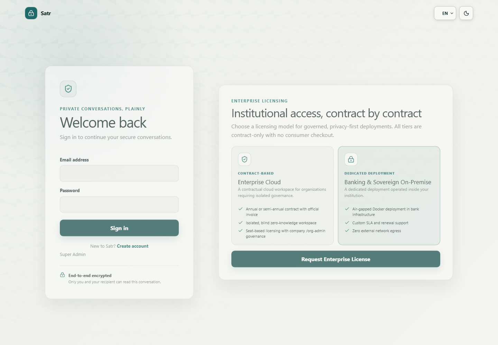
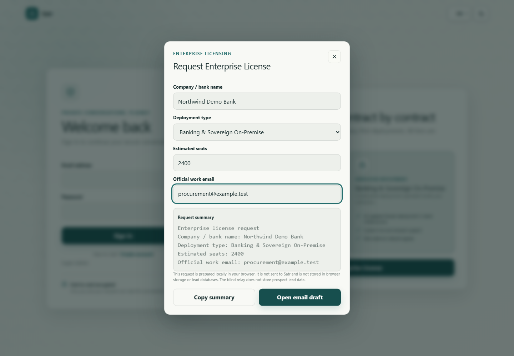
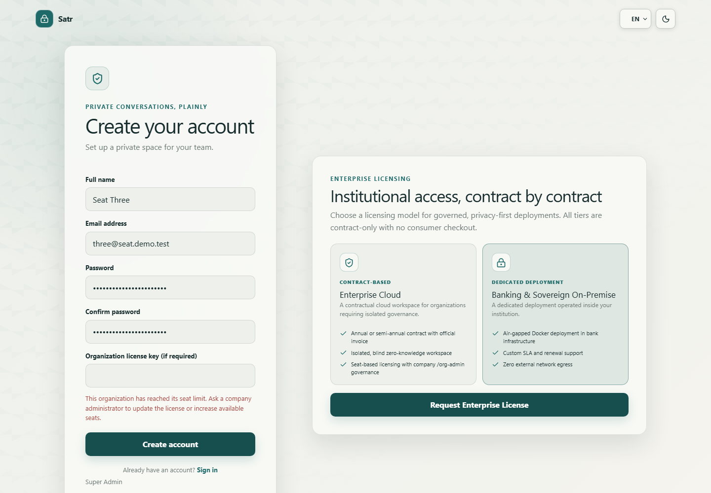
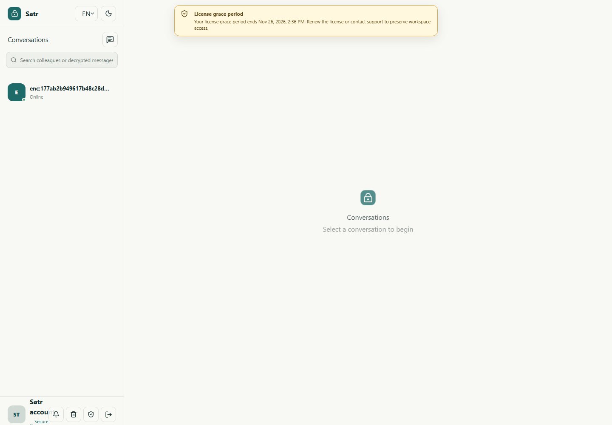
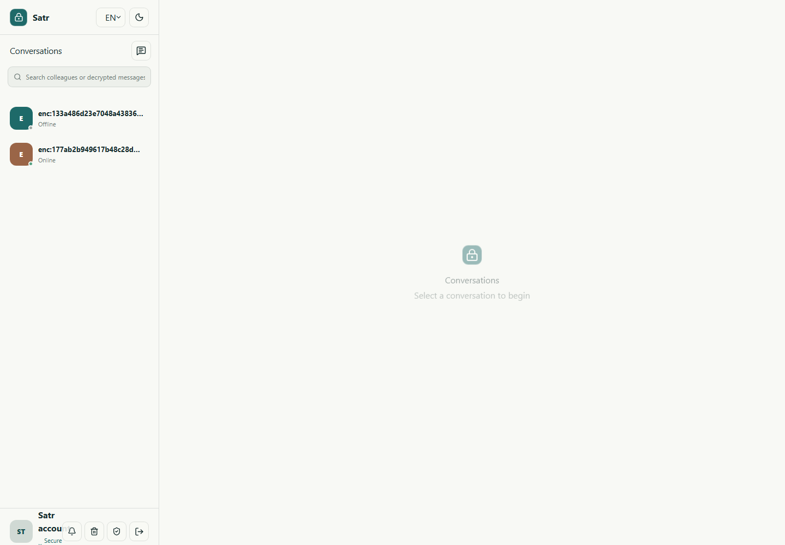

**Sprache:** [English](README.md) | **Deutsch**

# SATR Enterprise
### Blind-Zero-Knowledge-E2EE-Kommunikationsplattform für Unternehmen, Behörden & Banken

---

## Überblick

**SATR Enterprise** ist eine Ende-zu-Ende-verschlüsselte (E2EE) Kommunikationsplattform auf Unternehmensniveau, die speziell für Konzerne, regulierte Institutionen und Bankenumgebungen entwickelt wurde, in denen Metadaten-Lecks, serverseitige Nachrichtenspeicherung oder externe Cloud-Zugriffe ausgeschlossen sein müssen.

Im Gegensatz zu herkömmlichen Business-Messengern arbeitet SATR als **Blind-Zero-Knowledge-Relay**: Nachrichten werden ausschließlich im flüchtigen Arbeitsspeicher (RAM) weitergeleitet und niemals auf Festplatten oder in Datenbanken gespeichert.

---

## Zentrale Sicherheitsarchitektur

- **Zweistufige Ende-zu-Ende-Verschlüsselung:** Nicht exportierbare `ECDH P-256`-Geräteschlüssel (WebCrypto) kombiniert mit ephemerem `ECDH P-256`-Schlüsselaustausch pro Nachricht, `HKDF-SHA-384`-Schlüsselableitung und `AES-256-GCM`-Verschlüsselung.
- **Schutz vor Verkehrsanalyse:** Festes 512-Byte-Padding verschleiert Nachrichtenlängen und Kommunikationsmuster.
- **Echtes Zero-Storage-Prinzip:** Weder Nachrichteninhalte noch Anhänge oder Gesprächsverläufe werden jemals auf dem Server gespeichert.
- **Anonyme Identitäten & kein IP-Logging:** Mitarbeiter-Identitäten werden vor der Speicherung durch gesalzene `HMAC-SHA256`-Hashes anonymisiert; sämtliche Client-IP-Adressen werden auf Infrastruktur-Ebene verworfen.
- **Strikte Rollentrennung:** Unternehmensadministratoren (`/org-admin`) verwalten Teams, freigegebene Mitarbeiter-Hashes und Sitzplatzkontingente, ohne jemals Zugriff auf kryptografische Schlüssel oder Klartextinhalte zu erhalten.

---

## Institutionelle Lizenz- und Bereitstellungsmodelle

SATR Enterprise wird ausschließlich über formelle B2B-Verträge lizenziert (ohne öffentliche Zahlungs-Gateways):

| Modell | Zielgruppe | Infrastruktur & Governance |
| :--- | :--- | :--- |
| **Enterprise Cloud** | Unternehmen, Kanzleien & regulierte Teams | Isoliertes Blind-Relay, jährlicher/halbjährlicher B2B-Vertrag mit Rechnung, strikte Sitzplatzbegrenzung und `/org-admin`-Verwaltung. |
| **Banking & Sovereign On-Premise** | Banken, Finanzinstitute und staatliche Stellen | Vollständig vom Internet getrennte (Air-Gapped) Docker-Bereitstellung im eigenen Rechenzentrum ohne ausgehenden Netzwerkverkehr sowie individuelles SLA. |

---

## Verifizierte Plattform-Vorschau

### 1. B2B Enterprise- & Banking-Lizenzportal

### 2. Datenschutzkonforme Lizenzanfrage
*Erstellt eine strukturierte B2B-Vertragsanfrage lokal im Browser, ohne unverifizierte Kontaktdaten auf dem Blind-Relay zu speichern.*

### 3. Strikte Durchsetzung der Sitzplatzgrenze

### 4. Nicht-destruktive Kulanzfrist & Vertragsverlängerung
*Abgelaufene Lizenzen wechseln in eine konfigurierbare Kulanzfrist, in der bestehende Konten und Allowlists vollständig erhalten bleiben und nach Verlängerung sofort wieder freigeschaltet werden.*

---

## Lizenzierung & Kontakt

Für eine Evaluierung, Architekturberatung oder ein individuelles Banking-SLA nutzen Sie bitte direkt die Funktion **Request Enterprise License** im Plattform-Portal oder kontaktieren Sie den Entwickler über GitHub.