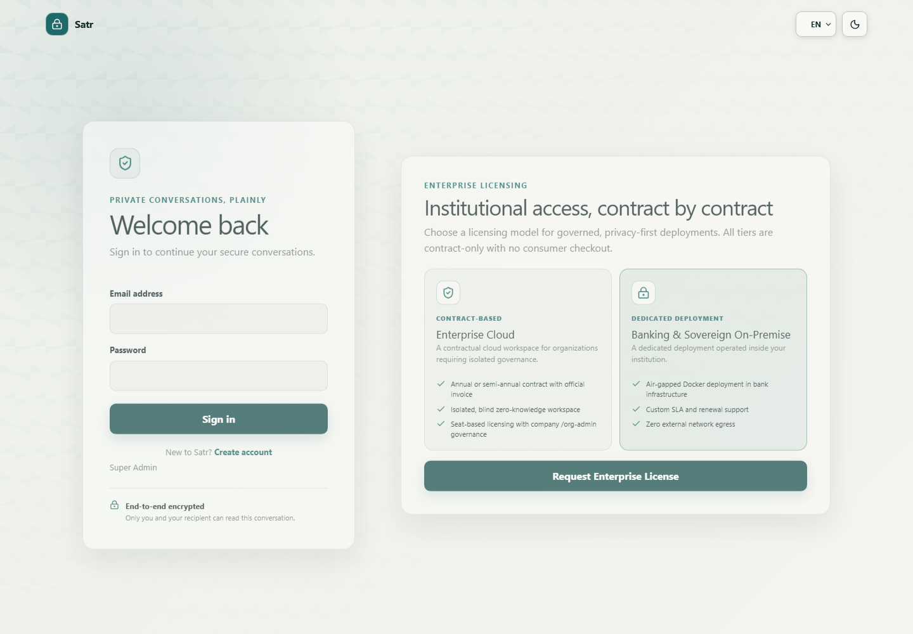
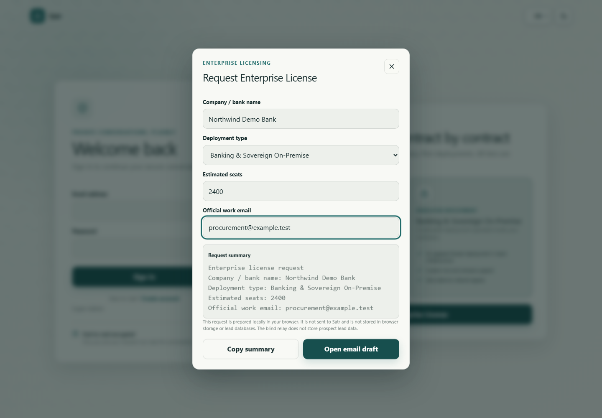
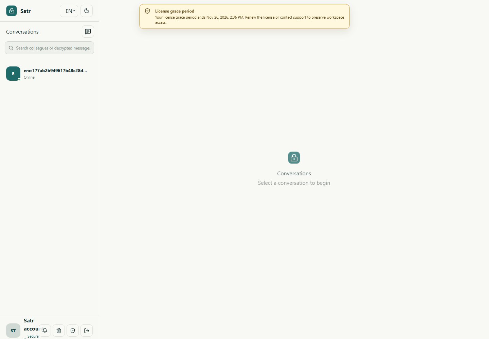
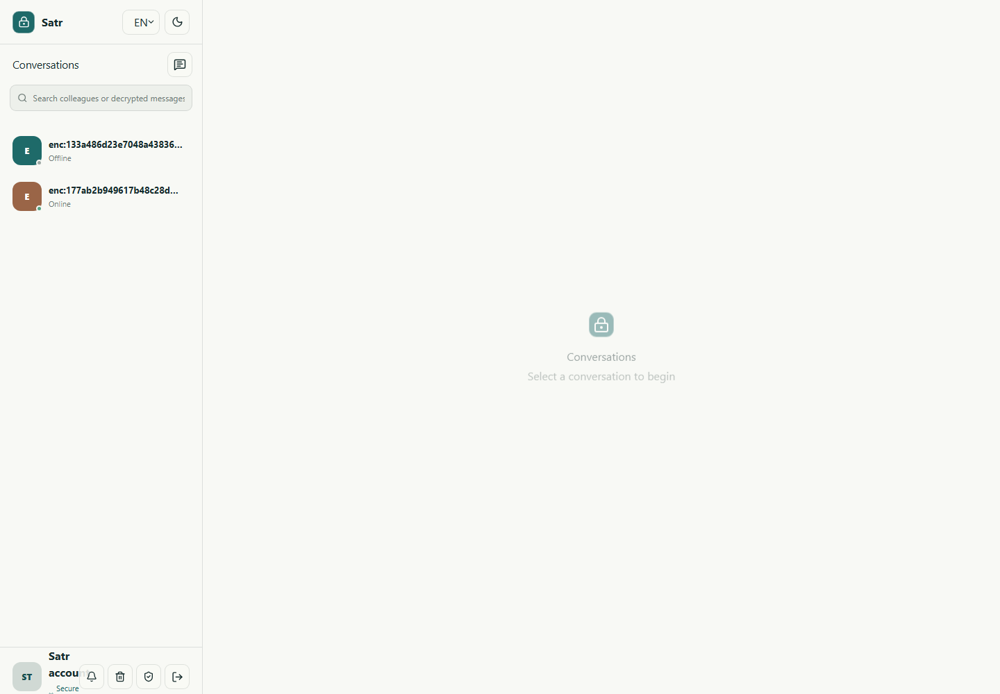



# 🛡️ سِتر | SATR Enterprise
### منصة التواصل المؤسسي والبنكي المشفرة بتقنية العمى التام (Blind Zero-Knowledge E2EE)

**نظام تواصل فائق الأمان مصمم خصيصاً للشركات، المؤسسات الكبرى، والبنوك — حيث لا يملك الخادم (Server) أي قدرة تقنية على قراءة الرسائل أو معرفة هوية الموظفين أو الاحتفاظ بسجلات المحادثات.**

[طلب عرض سعر وتفعيل ترخيص مؤسسي](#-طلب-ترخيص-مؤسسي-أو-نسخة-البنوك) • [المميزات الأمنية](#-الركائز-الأمنية-والمعمارية) • [معاينة الواجهات](#-معاينة-واجهات-المنصة) • [باقات الشركات والبنوك](#-نماذج-التعاقد-والنشر)

---

## 🔒 الركائز الأمنية والمعمارية

* **تشفير طرفي ثنائي الطبقة (Dual-Layer E2EE `v2`):**
  * توليد مفاتيح هوية غير قابلة للتصدير (`Non-Extractable P-256 ECDH`) داخل متصفح/جهاز كل موظف (`IndexedDB`).
  * اشتقاق مفتاح جلسة مؤقت مستقل لكل رسالة (`Per-Message Ephemeral P-256` + `HKDF-SHA-384`) مع تشفير `AES-256-GCM` وربط سياقي (`AAD`) يمنع التلاعب أو إعادة الإرسال (`Replay Protection`).
  * تغليف الحزم (`512-byte Traffic Padding`) لإخفاء الطول الحقيقي للرسائل ومنع تحليل حركة البيانات.
* **معمارية العمى التام وانعدام التخزين (Blind Zero-Knowledge & Zero-Storage):**
  * **لا رسائل على السيرفر:** يعمل الخادم كوسيط ذاكرة مؤقت (`In-Memory RAM Relay`) يحذف الحزم المشفرة فور تسليمها، مع حفظ السجل المشفر محلياً على جهاز الموظف فقط وزر مسح فوري للطوارئ (`Panic Wipe`).
  * **إخفاء الهويات والـ IP:** لا يُخزَّن أي بريد إلكتروني صريح في قاعدة البيانات (`HMAC-SHA256 Blind Identity`)، مع تعطيل تسجيل عناوين الـ IP في سجلات الخادم و`Nginx`.
* **فصل الصلاحيات المؤسسي (Strict Role Separation):**
  * **مدير الشركة (`/org-admin`):** تحكم كامل في فرق العمل، الأقسام، صلاحيات الانضمام، وإدارة المقاعد داخل المؤسسة دون تدخل من مزود الخدمة.
  * **مزود المنصة (`/admin`):** إدارة التراخيص والمقاعد فقط دون أي وصول لقوائم الموظفين أو مجموعاتهم الداخلية.
* **بوابة حماية صارمة (Environment & Anti-Bot Shield):**
  * حظر أدوات السحب والفحص الآلي، واقتصار التشغيل على أنظمة التشغيل الحديثة (`Windows 10+`، `Android 10+`، `iOS 15+`، `macOS 12+`) والمتصفحات الموثقة.

---

## 📸 معاينة واجهات المنصة

### 1. الواجهة الرئيسية وباقات الشركات والبنوك

  

### 2. نموذج طلب ترخيص مؤسسي (B2B Contract Flow)

  

### 3. تطبيق سقف المقاعد الصارم للمؤسسات (Seat Cap Governance)

  

### 4. تنبيه فترة السماح المرنة دون فقدان البيانات (Grace Period)

  

### 5. استعادة مساحة العمل بالكامل بعد التجديد

---

## 🏢 نماذج التعاقد والنشر (B2B & Banking)

تُقدَّم منصة **سِتر (Satr)** حصرياً عبر عقود ترخيص رسمية للجهات الاعتبارية:

| النموذج | الفئة المستهدفة | آلية النشر والتشغيل |
| :--- | :--- | :--- |
| **Enterprise Cloud** | الشركات والمؤسسات التجارية | مساحات عمل سحابية معزولة تماماً، تراخيص بعدد المقاعد، وفترة سماح مرنة عند التجديد السنوي. |
| **Banking & Sovereign On-Premise** | البنوك والهيئات السيادية | نشر ذاتي كامل (`Docker / Air-Gapped`) داخل البنية التحتية الخاصة بالبنك دون خروج أي حزمة للشبكة الخارجية. |

---

## 📩 طلب ترخيص مؤسسي أو نسخة البنوك

للحصول على عرض سعر، طلب نسخة تجريبية للمؤسسات، أو التعاقد على نسخة الاستضافة الذاتية للبنوك:

* **المطور والمعماري للنظام:** [Ahmed Ali Soliman](https://github.com/Ahmed-Ali-Soliman)

© 2026 SATR Enterprise Security. جميع الحقوق محفوظة — الكود المصدري محمي بموجب حقوق الملكية الفكرية وتراخيص الاستخدام التجاري.

