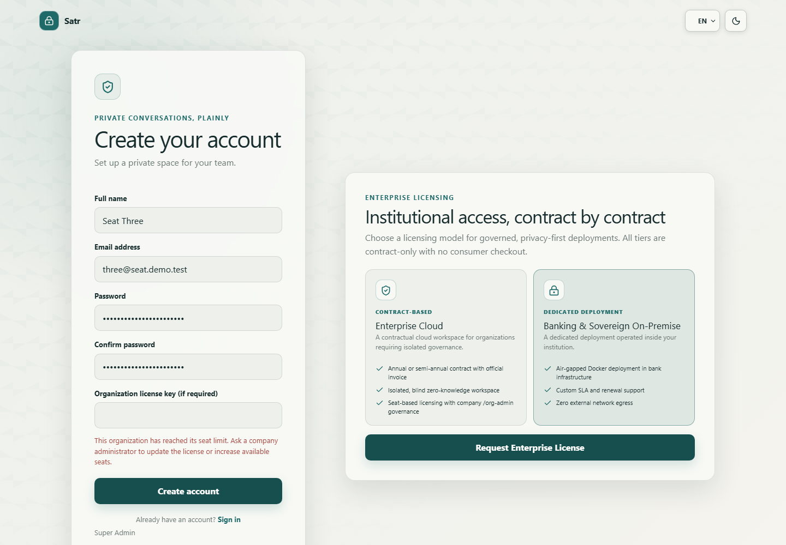

**Language:** **English** | [Deutsch](README.de.md)

# SATR Enterprise
### Blind Zero-Knowledge E2EE Messaging Platform for Enterprises, Sovereign Entities & Banks

---

## Overview

**SATR Enterprise** is an institutional-grade, end-to-end encrypted (E2EE) messaging platform engineered specifically for organizations, regulated institutions, and banking environments where metadata leaks, server-side message retention, or third-party cloud exposure are unacceptable.

Unlike conventional enterprise chat tools that store message histories or rely on server-managed keys, SATR operates as a **Blind Zero-Knowledge Relay**: messages exist strictly in volatile memory during active delivery and are never persisted to disk.

---

## Core Security Architecture

* **Dual-Layer End-to-End Encryption:** Non-extractable WebCrypto `ECDH P-256` device identity keys paired with per-message ephemeral `ECDH P-256` key exchange, `HKDF-SHA-384` k derivation, and `AES-256-GCM` authenticated encryption.
* **Traffic Analysis Resistance:** Fixed 512-byte cryptographic padding obscures message length and communication patterns.
* **True Zero-Storage Relay:** Zero message content, attachments, or conversation histories are ever written to server databases or disk storage.
* **Blind Identity & Zero IP Logging:** User email identifiers are transformed into salted `HMAC-SHA256` digests before storage, and reverse-proxy access logs strip all client IP addresses.
* **Strict Role & Governance Separation:** Company Administrators (`/org-admin`) manage internal teams, allowlisted employee hashes, and seat allocations without ever accessing cryptographic keys or plaintext content.

---

## Institutional Licensing & Deployment Tiers

SATR Enterprise is licensed exclusively through formal B2B institutional contracts (no consumer checkout or self-serve credit card gateways):

| Tier | Target Organizations | Infrastructure & Governance |
| :--- | :--- | :--- |
| **Enterprise Cloud** | Corporates, Legal Firms & Regulated Teams | Isolated multi-tenant blind relay, annual/semi-annual B2B contract & invoice, strict seat-cap enforcement, and `/org-admin` governance. |
| **Banking & Sovereign On-Premise** | Banks, Financial Institutions & Sovereign Entities | Fully air-gapped Docker self-hosted deployment inside the institution's own private data center with zero external network egress and custom SLA; |

---

## Verified Platform Previews

### 1. B2B Enterprise & Banking Licensing Portal

### 2. Privacy-Safe Institutional License Inquiry Flow
*Generates a structured B2B contract inquiry locally without storing unverified lead PII on the blind relay..*

### 3. Strict Organization Seat-Cap Enforcement

### 4. Non-Destructive Grace Period & Contract Renewal
*Expired licenses enter a configurable waiting window that preserves employee accounts and allowlists without data loss, restoring full access immediately upon renewal.*

---

## Licensing & Institutional Inquiries

To request an institutional deployment evaluation, architecture briefing, or custom banking SLA, launch the **Request Enterprise License** flow directly within the platform portal or contact the project maintainer via GitHub.
